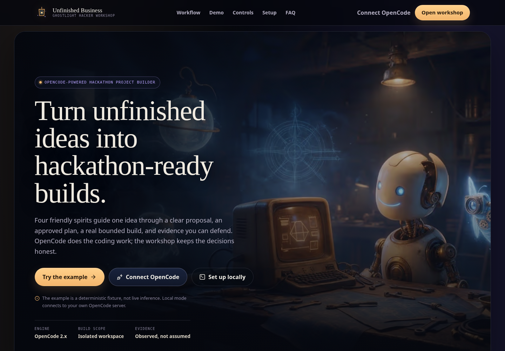

# Unfinished Business

**Turn unfinished ideas into hackathon-ready builds.**

Unfinished Business is an OpenCode-powered hackathon project builder. Four friendly spirits guide one idea through a clear proposal, an approved plan, a real bounded build, and evidence you can defend.



## What it is

- A **landing page** at `/` that explains the product, the four roles, OpenCode's role, and the three honest usage paths.
- A **guided deterministic example** at `/demo`: a versioned Campus Umbrella Relay fixture with Play/Pause, step, replay, reset, four inspectable spirit tabs, a representative diff and check, Witness findings, and an optional 90-second presentation mode at `/demo?presentation=1`. It does not call a model or read a repository.
- The **real workshop** at `/workshop`, which connects to a local OpenCode server and records what actually happened.
- A **first-run connection and discovery flow** that checks a supported OpenCode server, lists the models/providers/agents it actually reports, and lets the builder choose a model and reported reasoning variant. Provider API keys stay inside OpenCode.
- A **read-only hosted demo** and a **private hosted** mode. Neither reaches into a visitor's local repository.
- A versioned **schema v4** contract for source metadata, Oracle intake, structured memory, candidate section revisions, model access/privacy/spending preferences, structured provider errors, and late-result-safe operation states. Explicit migrations keep older projects usable.

OpenCode supplies the agent loop, model access, native tools, permissions, execution, interruption, and native sessions. Unfinished Business adds the four-stage workshop, exact-version approvals, dependency invalidation, evidence views, the onboarding/discovery flow, and the Ghostlight interface. It does **not** ship a second coding harness or a general command executor.

| Spirit | Role |
|---|---|
| Oracle | Clarify an idea into a product proposal and open questions |
| Architect | Draft one planning section and wait for approval of that exact version |
| Maker | Perform an approved, bounded native edit through OpenCode |
| Witness | Inspect evidence in a fresh session and prepare honest review drafts |

## Three honest usage paths

**Hosted demo** — `UB_DEPLOYMENT_MODE=hosted-demo`. A public, deterministic sample. It has no OpenCode process, provider credentials, session token, visitor persistence, or repository access. Every non-GET `/api/*` request returns `403 DEMO_READ_ONLY`.

**Private hosted** — `UB_DEPLOYMENT_MODE=private-hosted`. A password-protected Render or self-hosted instance with a private disk and a loopback OpenCode child. Maker edits the server's isolated demo workspace. A hosted browser cannot edit a visitor's machine.

**Full local mode** — `UB_DEPLOYMENT_MODE=local` (default). The browser app, local API, and pinned OpenCode server run on the builder's machine over loopback. Maker's edit in this release is bounded to an isolated demo workspace; arbitrary repository mounts are not implemented.

The landing page exposes three distinct actions: **Try the example** (`/demo`), **Watch the guided workflow** (`/demo?presentation=1`), and **Run live with OpenCode** (`/workshop`). The example is always labeled as a prerecorded fixture; the live native session remains `NOT_RUN`.

Models are discovered from OpenCode rather than assumed. New projects default to **All accessible models**, so any model OpenCode reports as available can be selected. A project can deliberately switch to **Free and local only**, which blocks paid and unknown-price remote models. Paid or unknown-price remote models require an explicit first-use confirmation; the app never silently substitutes a model or makes a paid request without that confirmation. An optional USD session spending limit can be set, and the deployment can impose a stricter `UB_MAX_SESSION_COST_USD` ceiling. Cost is checked against the value OpenCode reports; an unknown-price provider may report it only after a request.

## Quick start

Prerequisites: Linux, Node **22.14+**, npm, and a supported OpenCode 2.x server. Copying `.env.example` to `.env` is optional for local work; the first-run wizard can hold the server password in memory.

```bash
npm ci
cp .env.example .env   # optional
```

Terminal 1 — OpenCode:

```bash
./node_modules/@opencode/cli-linux-x64-baseline/bin/opencode serve --hostname 127.0.0.1 --port 4096
```

Terminal 2 — API:

```bash
npm run dev
```

Terminal 3 — interface:

```bash
npm run dev:web
```

Open `http://127.0.0.1:5173/`. The first-run wizard asks for the server URL and the password printed by `opencode serve`; provider accounts are connected inside OpenCode with `/connect`, and the model list comes from OpenCode's catalog.

For a single production process:

```bash
npm run build
npm start
```

Then open `http://127.0.0.1:4200/`. The detailed, tested guide is [docs/LOCAL_SETUP.md](docs/LOCAL_SETUP.md). All state and mutation API routes require the browser session token; the browser client obtains it from `/api/session` automatically.

## Verification

Run the release matrix:

```bash
npm run typecheck
npm test
npm run build
npm run budget
npm run test:visual
```

Current results (2026-11-01, Node 22.22.1, no live provider inference):

- **139 unit/integration/component tests pass**.
- **18 Playwright visual/accessibility tests pass** with committed snapshots, including guided demo wide/narrow/presentation captures.
- Initial JS is **194.0 KiB gzip**; all JS **266.4 KiB**; CSS **14.5 KiB gzip**; all hero variants **570.9 KiB** total.
- Keyboard focus order, dialog Escape, setup tab arrow keys, 200% text zoom, 390px overflow, reduced motion, and token contrast are checked.
- Demo playback, reset isolation, fixture/schema drift, 90-second timing, tab inspection, no-network behavior, and hosted-demo mutation rejection are covered.
- State migration deterministically upgrades schema v1, both supported v2 shapes, and schema v3 to v4 without dropping proposals, approvals, transcripts, operations, evidence, selected model data, provider policy, or limits.
- Model access policy, paid/unknown-price confirmation, optional spending limits, provider failure classification/redaction, and runtime confirmation gates are covered.
- Local and hosted-demo smoke journeys pass; the hosted demo makes no inference call and rejects mutation.
- OpenCode 2.0.32 live compatibility probe passed (version, catalog, and disposable session create/read/remove; no prompt or model call).
- Production dependency audit at `--audit-level=high` passes. `npm audit` still reports six moderate `glob`/`minimatch` advisories reachable through the Sentry bundler plugin during developer builds; the suggested fix is a breaking Sentry downgrade and was not applied.

`npm run test:visual` needs a Chromium executable. It prefers `PLAYWRIGHT_CHROMIUM_EXECUTABLE`, then system Chrome/Chromium, then Playwright's browser.

## Status and limitations

The prior release phases remain integrated. Upgrade Phase 1 adds model access policy, optional spending limits, informed paid/unknown-price confirmation, schema v4, and structured provider failure recovery while preserving the four-stage workflow and its approval gates.

Known limitations:

- The application is a trusted single-project tool, not a multi-tenant sandbox. Shared-host isolation, remote repository connectors, and a remote browser-to-local pairing flow are deferred.
- Maker edits only `UB_DATA_DIR/demo-workspace`; the Node check is not an OS sandbox.
- Model availability, pricing, quota, training terms, and billing are controlled by OpenCode/provider. The spending limit only checks cost OpenCode reports after a session; unknown-price providers may bill before that value is visible.
- The workspace privacy preference records intent; the app cannot attest every provider's training/retention contract. Provider rejections that mention training/data policy are explained as `PROVIDER_DATA_POLICY`.
- Backboard is not integrated and no partner category is claimed for installation alone. Sentry is configured but live release/source-map/trace verification requires authorized credentials and a deployment.
- No public hosted URL, recorded video, published article, or submission is asserted by this repository.
- A real recorded demonstration and final submission packaging remain separate acceptance work.

## Documentation

Canonical:

- [Product brief](docs/PRODUCT_BRIEF.md) — positioning, landing claims, three usage paths.
- [Architecture](docs/ARCHITECTURE.md) — routes, trust boundaries, persistence, modes, security.
- [Implementation plan](docs/IMPLEMENTATION_PLAN.md) — phase history and release gate.
- [OpenCode integration](docs/OPENCODE_INTEGRATION.md) — tested version/API surface, discovery, credentials ownership, sessions, limits.
- [Local setup](docs/LOCAL_SETUP.md) — tested commands and troubleshooting.
- [Hosted deployment](docs/HOSTED_DEPLOYMENT.md) — Render/private instance, demo policy, secrets, review procedure.
- [Tool catalog](docs/TOOL_CATALOG.md) — selected tools, honest availability, recommendation policy.
- [UX and visual system](docs/UX_AND_VISUAL_SYSTEM.md) — theme, tokens, components, character states, motion, accessibility, performance budget.
- [Operations and recovery](docs/OPERATIONS_AND_RECOVERY.md) — data layout, backups, migrations, retention, failure matrix.
- [Demo and submission](docs/DEMO_AND_SUBMISSION.md) — scenario, fixture provenance, playback/reset, exact claims, video beats, disclosure.
- [Decisions](docs/DECISIONS.md) — product, interface, demo, and hardening decisions.
- [Changelog](docs/CHANGELOG.md) — released changes.
- [Evidence index](docs/EVIDENCE.md) — requirements-to-evidence matrix, commands, limitations.
- [Release notes](docs/RELEASE_NOTES.md) — concise release handoff.

History and provenance:

- [Engineering blueprint](docs/history/ENGINEERING_BLUEPRINT.md) — superseded planning record.
- [Product idea packet](docs/history/Unfinished-Business-Idea-Packet-v1.md) — approved discovery record.
- [Render deployment notes](docs/history/RENDER_DEPLOYMENT.md) — superseded by the hosted deployment guide.
- [Sentry and OpenCode setup](docs/history/SENTRY_AND_OPENCODE_SETUP.md) — superseded by integration/deployment guides.
- [Complete local prompt set](docs/prompts/README.md) — runtime Prompts 0–3 and project overrides.

## Development policy

- Repository: [kernelKain/unfinished-business](https://github.com/kernelKain/unfinished-business).
- Work on the existing `main` branch. Do not create phase branches.
- Complete and verify each phase, then make one commit for that phase before starting the next phase.
- Steps are work/checklist units, not individual commits. Commit subjects describe the change without phase or step numbering.
- Preserve unrelated changes. A blocked commit blocks entry to the next implementation phase; do not bypass access restrictions.
- No fabricated testimonials, usage figures, awards, or live-run claims.
- No second coding harness, remote repository mount, or public arbitrary-execution sandbox.

## Delivery

The first release targets a local browser on Linux. A real recorded demonstration and a reproducible local-start guide provide judge access; hosted code execution is outside this release. Backboard, Sentry Agent Tracing, and Entire remain selected partner targets, with qualification conditional on meaningful actual use and evidence. Publication, deployment, domain registration, credit claiming, and submission remain pending separate authorization.

## License

[MIT](LICENSE). Dependency, prompt, and asset attribution must be checked before redistribution. The generated hero asset's prompt and provenance are documented in [docs/UX_AND_VISUAL_SYSTEM.md](docs/UX_AND_VISUAL_SYSTEM.md).
